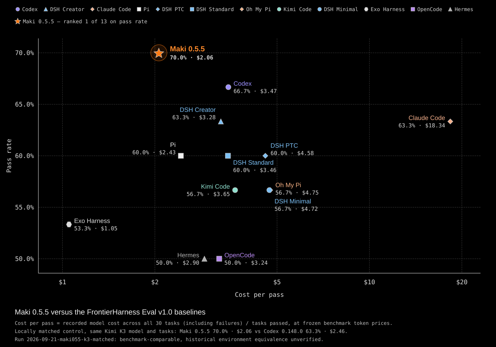

> **Personal fork.** This repository ([cybershape/maki](https://github.com/cybershape/maki)) is a strongly opinionated personal fork of upstream [Maki](https://github.com/tontinton/maki). It is **not** the upstream project; providers, defaults, and UI behavior differ. For the official agent, use [tontinton/maki](https://github.com/tontinton/maki).

**Changes in this fork (vs [tontinton/maki](https://github.com/tontinton/maki) `main`):**

- **Providers:** Built-in and bundled provider plugins are trimmed to the OpenAI **Responses API** path only (upstream’s multi-vendor built-ins and provider Lua plugins are removed). The Responses integration adds fuller `/models` discovery parsing and reasoning-effort / thinking-level handling for OpenAI-family models; CLI auth is aligned with that stack.
- **Tool call reasons (`toolcall_reason`):** Injects an optional `toolcall_reason` parameter into every tool schema, prompting models to provide a concise, intent-focused reason (omitting redundant file names) for invoking the tool. The reason is displayed directly on the tool header / row title in the TUI (e.g. `reading main entry point · src/main.rs:10-29`) and stripped before execution so tool handlers receive clean arguments. In `compact_tools` mode, child tools inside `batch` calls also format and display their `toolcall_reason` in the tree.
- **Tools & prompts:** Built-in directory listing tool is renamed from `list` to `list_dir`. When `list_dir` is disabled, it is hidden from the tools exposed to the model and from `code_execution` callable tools, but `code_execution` preserves its underlying `files.inspect` sandbox capability for `os`/`pathlib` inspection. The `code_execution` tool description documents Monty Python subset limitations (e.g. eager generator evaluation into lists, missing `iter()`, and unsupported syntax like `:=`, `del`, or `*args` call unpacking) to prevent models from generating failing code. System prompt hints dynamically adapt when `batch`, `code_execution`, or `task` are disabled. MCP servers are not advertised as wire tools: the model calls them as Python libraries inside `code_execution` (`library_help` documents them). External MCP library and function names with non-identifier characters (such as hyphens) are normalized to valid Python identifiers across `code_execution` descriptions, sandbox namespace mounting, and `library_help`. Sessions saved by an older build stored those MCP tools on the request and will not resume on this fork; start a new session.
- **TUI & interaction:**
  - `compact_tools` mode grouping tools and thinking blocks with durations, waiting animations, child tool summaries, accurate summed thinking duration in turn completion stats, and full preservation across session restore. Visible entries before folding are configurable via `compact_lines` (default `10`, `0` folds all entries). The hidden-count line (`... (X hidden)`) expands on click to reveal all calls. Clicking a row opens a detail popup with full untruncated input and output, horizontal inner padding, top scroll default, and `j`/`k` shortcut keys to navigate between previous and next items.
  - Prompt queue with steer shortcut (Shift-Enter) to steer a running turn, plus recall editing for queued and previous prompts.
  - Context-window usage progress bar in status bar using theme colors; per-turn stats line upon completion.
  - Markdown LaTeX math expression rendering via `txm`.
  - OSC 7501 Program Status Protocol support for terminal status reporting; inline image rendering for Rex (`TERM_PROGRAM=rex`).
  - Stylized user messages with chevron prefix and background tint.
  - Layout and display options: `show_cost`, `prefer_model_name`, `max_width` centering (supporting column counts, viewport ratios like `0.8`, and negative offsets like `-10`), and column-boundary text wrapping.
  - Viewport resize debouncing (50ms debounce with 200ms throttle) to prevent continuous repainting and reflow thrashing during window resize animations and dragging.
  - Model picker (`/model`): When the current model is present in `Recent`, the dialog defaults to selecting the entry in the `Recent` section instead of jumping to the provider section.
- **ACP server:** On-disk model cache with wait-for-discovery on first run; session `thought_level` (and aliases) for reasoning effort; `usage_update` on session load, model changes, refresh, and compaction; model display names in config options; question-tool and model-metadata fixes.
- **Storage & history:** Timestamps recorded on session log records (`MessageRecord`, `ContentBlockRecord`); duration tracking for individual thinking blocks.
- **Instructions:** Per-agent and global switches for which third-party instruction files (e.g. `CLAUDE.md`, `.cursorrules`) are loaded.
- **Standby & sleep resilience:** Detects system sleep/wake transitions via cross-platform clock drift heuristics; automatically compensates tool deadlines by the sleep duration so background/foreground commands are not mistakenly killed on wake; enables TCP keepalive on HTTP connections; immediately aborts stale SSE streams on wake instead of waiting for a 30s timeout; applies a wake-up grace period so initial connection attempts during Wi-Fi re-association do not deplete the 5-retry limit; and triggers automatic HTTP MCP transport reconnection upon wake.
- **CI & build:** Release builds run only on git tags for Windows, Linux, and macOS arm64 (no NetBSD and similar upstream targets); LTO disabled for non-release builds.


An AI coding agent optimized for minimal use of context tokens, while providing a great user experience.

## Benchmarks



[FrontierHarness Eval](https://frontierharness.org/) benchmark result, [click here to download report.zip](https://github.com/tontinton/maki/releases/download/v0.5.5/frontierharness-report-2026-09-21.zip)

## Features

### Context efficiency

* `index` tool - uses [tree-sitter](https://tree-sitter.github.io/tree-sitter) to parse supported programming languages to produce a high level skeleton of a file, with exact start-end lines of each item (e.g. a function's implementation is in lines 150-165). Encouraged to be used before reads. For my usage it adds 59 tok/turn but saves 224 tok/turn on read calls, saving 165 tok/turn.
* `code_execution` tool - uses [monty](https://github.com/pydantic/monty) to run an interpreter that has all other tools available as async functions. Maki uses it to filter / summarize / transform / pipe data to other tools as input, without it ever reaching and polluting the context window. Sandbox limited by time & memory.
* `task` tool - when delegating work to subagents, the AI chooses whether to run weak / medium / strong model of used provider. Think haiku / sonnet / opus.
* System prompt, tool descriptions, and tool examples are all concise, I've made sure not to bloat your context.
* Uses [rtk](https://github.com/rtk-ai/rtk) if you have it installed, disable with `maki.setup({ agent = { rtk = false } })` in your `init.lua`. Saves ~50% of bash output tokens. Remember bash is just 12% of total token usage, so 6% is nice, but saving on reads (65% of total) by using `index` gave me more benefit. I think I'll do bash output filtering like this myself in a future release.

### User experience

* SUPER fast startup, 60 FPS, and light on memory. Not running any JavaScript, using [ratatui](https://ratatui.rs) for TUI. Even the splash screen animation uses SIMD.
* Extend with neovim like Lua plugins - [Builtin plugins](https://github.com/tontinton/maki/tree/main/plugins), [User made plugins showcase](https://github.com/tontinton/maki/discussions/452), [Lua API reference](https://maki.sh/docs/lua-api/).
* Philosophy of not hiding anything - while other coding agents hide information as models improve (e.g. not showing number of lines read), maki leaves you in control.
* UI fits everything well on my small screen laptop.
* Full visibility of subagents - each subagent gets their own "chat window" you can easily navigate between using `/tasks` (Ctrl-X).
* Sensible permission system - when the agent runs `git diff && rm -rf /`, what do you think will happen in your current coding agent? It will treat it as `git *`. Maki uses tree-sitter to parse the bash command and figure out the permissions requested are `git *` and `rm *`. Disable using `--yolo`.
* SSRF protection on `webfetch` calls.
* A `memory` tool to keep long term context, just tell maki to remember something (sometimes it uses it automatically). Managed via `/memory` (view / edit / delete memories).
* Fuzzy search with Ctrl-F.
* `/btw` to run a command with the chat history without interfering with the current session.
* Rewind on Escape-Escape (no code rewind yet, only chat history).
* Attach images in prompts.
* 26 of the most popular themes.
* Resume sessions.
* Skills & MCPs.
* Opt-in [OpenTelemetry](https://maki.sh/docs/telemetry/) export, same format as Claude Code's.
* Plan mode.
* Run bash commands using `!`, or `!!` if you want maki to not know about it.
* `/cd` to change dir.
* Use `--print --output-format stream-json` to run UI-less. Output is compatible with Claude Code, so you can easily replace your existing solutions.

## Supported providers

* Anthropic - `ANTHROPIC_API_KEY` only (using OAuth is against TOS). Bedrock supported via `CLAUDE_CODE_USE_BEDROCK=1`.
* OpenAI - `OPENAI_API_KEY` and OAuth via `maki auth login openai`.
* xAI - `XAI_API_KEY` and OAuth via `maki auth login xai`.
* Google - `GEMINI_API_KEY`.
* Copilot - `GH_COPILOT_TOKEN` or an existing GitHub Copilot sign-in at `~/.config/github-copilot/`.
* Ollama - `OLLAMA_HOST` for local (e.g. `http://localhost:11434`), or `OLLAMA_API_KEY` for cloud.
* llama.cpp - `LLAMA_CPP_HOST` (e.g. `http://localhost:8080`), optionally `LLAMA_CPP_API_KEY`.
* Mistral - `MISTRAL_API_KEY`.
* Z.AI - `ZHIPU_API_KEY`.
* DeepSeek - `DEEPSEEK_API_KEY`.
* OpenRouter - `OPENROUTER_API_KEY`.
* Requesty - `REQUESTY_API_KEY`. Set `REQUESTY_BASE_URL=https://router.eu.requesty.ai/v1` for the EU region.
* Synthetic - `SYNTHETIC_API_KEY`.
* Regolo - `REGOLO_API_KEY`. EU-hosted open-weight models.
* TensorX - `TENSORX_API_KEY`.
* OpenCode Zen - `OPENCODE_API_KEY`, or the free `public` key for zero-cost models. Models from the models.dev catalog.
* OpenCode Go - `OPENCODE_API_KEY`. Models from the models.dev catalog.
* Aperture - `APERTURE_HOST` (e.g. `https://your-host.tailnet.ts.net`). No API key needed, Tailscale handles auth.

**Plugin providers** - a Lua plugin can register a provider with `maki.provider.register`, and its models behave like any built-in provider's. See [docs](https://maki.sh/docs/providers/#plugin-providers) for details.

## Installation

### Linux / macOS

```sh
# Download and read the script first (don't blindly trust shell scripts).
curl -fsSL https://maki.sh/install.sh -o install.sh
cat install.sh

# Then run.
chmod +x install.sh && sh install.sh
```

One-liner:

```sh
curl -fsSL https://maki.sh/install.sh | sh
```

Installs to `~/.local/bin`. Override with `MAKI_INSTALL_DIR`.

### Homebrew

```sh
brew install maki
```

### Windows (PowerShell)

```powershell
# Download and read the script first (don't blindly trust remote scripts).
irm https://maki.sh/install.ps1 -OutFile install.ps1
Get-Content install.ps1

# Then run.
.\install.ps1
```

One-liner:

```powershell
irm https://maki.sh/install.ps1 | iex
```

### Windows (Git Bash)

```sh
curl -fsSL https://maki.sh/install.sh | sh
```

Both install to `%LOCALAPPDATA%\maki` and add it to your user PATH. Override with `MAKI_INSTALL_DIR` / `$env:MAKI_INSTALL_DIR`.

### Living on the edge (main branch)

```sh
cargo install --locked --git https://github.com/tontinton/maki.git maki
```

### With Nix

```sh
nix run github:tontinton/maki
```

Or download a pre-built binary from [GitHub Releases](https://github.com/tontinton/maki/releases/latest).

## ACP

Run `maki acp` or configure your ACP supporting editor to use maki, e.g. in [Zed](https://zed.dev/)'s `settings.json`:

```json
"agent_servers": {
  "Maki": {
    "default_config_options": {
      "model": "deepseek/deepseek-flash"
    },
    "type": "custom",
    "command": "maki",
    "args": ["acp"],
    "env": {}
  }
}
```

## Documentation

More info at the [official docs](https://maki.sh/docs).

## Community

[](https://discord.gg/8VKuA4naC3)

## Example config

[tontinton/makiconf](https://github.com/tontinton/makiconf) - includes a [semble](https://github.com/MinishLab/semble) tool (Lua code) for semantic code search, and an [ast-grep](https://ast-grep.github.io) MCP server for AST-based search and replace.

> DISCLAIMER: >90% of code in maki was written by maki, guided by humans. Some parts of the code are not as good as what I would've made in the artisanal hand-made style. But it's also not slop / vibe coded, and can easily be refactored if needed nowadays.
