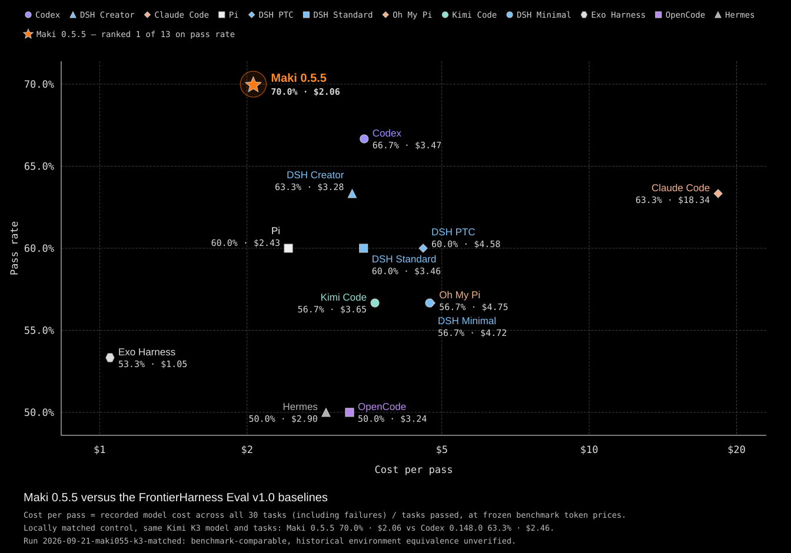

> **Personal fork.** This repository ([cybershape/maki](https://github.com/cybershape/maki)) is a strongly opinionated personal fork of upstream [Maki](https://github.com/tontinton/maki). It is **not** the upstream project; providers, defaults, and UI behavior differ. For the official agent, use [tontinton/maki](https://github.com/tontinton/maki).

**Changes in this fork (vs [tontinton/maki](https://github.com/tontinton/maki) `main`):**

- **Providers:** Built-in and bundled provider plugins are trimmed to the OpenAI **Responses API** path only (upstream’s multi-vendor built-ins and provider Lua plugins are removed). Provider management belongs in dedicated tools such as [magpie](https://github.com/yetone/magpie), with Maki consuming a unified Responses API endpoint. The Responses integration adds fuller `/models` discovery parsing and reasoning-effort / thinking-level handling based on model capabilities and metadata; CLI auth is aligned with that stack.
- **Tool call reasons (`toolcall_reason`):** Injects an optional `toolcall_reason` parameter into every tool schema, prompting models to provide a concise, intent-focused reason (omitting redundant file names) for invoking the tool. The reason is displayed directly on the tool header / row title in the TUI (e.g. `reading main entry point · src/main.rs:10-29`) and stripped before execution so tool handlers receive clean arguments. In `compact_tools` mode, child tools inside `batch` calls also format and display their `toolcall_reason` in the tree. The `bash` tool takes `toolcall_reason` instead of upstream's free-form `description` param; do not re-add `description` when merging upstream (a merge on 2026-10-31 accidentally kept both).
- **Tools & prompts:**
  - Windows loads a bundled `powershell` tool and leaves `bash` off. Other platforms keep `bash` on and leave `powershell` off. `plugins.<name>.enabled` overrides either default. `powershell` takes `toolcall_reason` instead of a free-form `description`. At load, `pwsh.exe` on `PATH` selects PowerShell 7 (it is not launched to read a version) and otherwise `powershell.exe`. The tool description follows that choice: PowerShell 7 gets `&&` / `||`, the ternary, and `??`; Windows PowerShell 5.1 is told to avoid `&&` and `||`. On 5.1 the tool prepends `[Console]::OutputEncoding` / `$OutputEncoding` UTF-8 setup so piped output decodes correctly instead of producing mojibake.
  - Built-in directory listing tool is renamed from `list` to `list_dir` to avoid shadowing Python’s built-in `list` in the `code_execution` sandbox. When `list_dir` is disabled, it is hidden from the tools exposed to the model and from `code_execution` callable tools, but `code_execution` preserves its underlying `files.inspect` sandbox capability for `os`/`pathlib` inspection.
  - The `code_execution` tool description documents Monty Python subset limitations (e.g. eager generator evaluation into lists, missing `iter()`, unsupported syntax like `:=`, `del`, or `*args` call unpacking, no `errors=`/`encoding=` in `open()`, no `.relative_to()` on `Path`, string-only replacements in `re.sub()`, and prohibition of file/OS operations inside synchronous callbacks like `sorted(key=...)` or `max(key=...)`) to prevent models from generating failing code.
  - Host-provided standard library modules: The `code_execution` sandbox intercepts Python imports and provides built-in host implementations for `urllib.parse` (covering `urlparse`, `urlsplit`, `urlunparse`, `urlunsplit`, `urljoin`, `quote`, `unquote`, `quote_plus`, `unquote_plus`, `parse_qs`, `parse_qsl`, and `urlencode`) and `glob` (`glob`, `iglob`, `escape`), pre-imported in the execution preamble so standard Python URL manipulation and path matching succeed without `ModuleNotFoundError`.
  - Child tool timeout preservation in `code_execution`: When `code_execution` dispatches inner tool calls (such as `bash` or `webfetch` via `await` or `gather`), it preserves each child tool's own default deadline (e.g. `bash`'s 120s timeout) instead of truncating them to `code_execution`'s 30s script execution budget, unless an explicit timeout is passed on the child call or relaxed by an outer script timeout.
  - System prompt hints and the `code_execution` tool description dynamically adapt when `batch`, `code_execution`, or `task` are disabled. When `batch` is disabled and `code_execution` is available, prompts and `code_execution`'s description advise using `code_execution` with `await gather(...)` to perform parallel batch tool calls.
  - MCP servers are not advertised as wire tools: the model calls them as Python libraries inside `code_execution` (`library_help` documents them). External MCP library and function names with non-identifier characters (such as hyphens) are normalized to valid Python identifiers across `code_execution` descriptions, sandbox namespace mounting, and `library_help`. Sessions saved by an older build stored those MCP tools on the request and will not resume on this fork; start a new session.
  - Added Vue single-file component (`.vue`) indexing support to the `index` tool, covering top-level SFC blocks (`<template>`, `<script>`, `<style>`), template tag hierarchy with custom component detection, and script symbol extraction for Composition API and Options API; C# indexing recurses into file-scoped and block-scoped namespace bodies.
  - Added F# (`.fs`, `.fsi`, `.fsx`) indexing support to the `index` tool using `tree-sitter-fsharp`, covering namespaces, top-level and nested modules, open imports, classes, interfaces/traits, records, discriminated unions, enums, type abbreviations, let bindings (functions and constants), and test detection.
  - Added `go.mod` manifest indexing support to the `index` tool using `tree-sitter-gomod-orchard`, extracting module declarations, Go language versions, toolchains, require dependencies (with inline comments/indirect markers), replace directives, exclude directives, retract versions, tools, and godebug settings.
  - The `bash` tool automatically strips ANSI color and terminal control escape sequences (`CSI`, `OSC`, 2-character escapes, and carriage return overwrites) during stdout/stderr capture, and sets `NO_COLOR=1` on spawned processes to prevent context token waste and transcript distortion.
  - Stale-read check optimization: `FileAccess` incorporates a content-hash fast-path using SHA-256 (up to 10MB) so touched files or metadata-only timestamp changes without actual content drift are automatically refreshed without interrupting the model with false-positive `file changed since last read` errors; the `write` tool declares `stale_read_check = false` to bypass stale-read checks for full-file replacements while preserving mutual exclusion write locks.
- **TUI & interaction:**
  - `compact_tools` mode grouping tools and thinking blocks with durations, waiting animations, child tool summaries, single-line thinking summaries with `↵` newline separators, accurate summed thinking duration in turn completion stats, and full preservation across session restore. When questions asked via the `question` tool are answered, each question's answer is displayed directly under the `question` entry as a next-level child node (`Header: Answer`, falling back to `Q1: Answer`), with full detail inspection on click and preservation across session restore. Background `bash` commands seal the active compact group, render as standalone tool rows in the original style with their background badges and task tabs, and start a new compact group for subsequent tools or thinking. Visible entries before folding are configurable via `compact_lines` (default `10`, `0` folds all entries). The hidden-count line (`... (X hidden)`) expands on click to reveal all calls. Clicking a row opens a detail popup with full untruncated input and output, horizontal inner padding, a 50% minimum height with non-shrinking watermark sizing during item switching, Python syntax highlighting for `code_execution` input without raw JSON formatting, top scroll default, `j`/`k` shortcut keys to navigate between previous and next items, and clicking outside the popup modal closes it.
  - `task_message` shows the message text as its tool header / compact row (instead of the opaque task id) when no `toolcall_reason` is given.
  - `plugins.task.enabled = false` hides only the model's `task` and `task_message` tools; the plugin still loads, so `/tasks`, `Ctrl+X` and `task_stop` keep serving background tasks of other plugins (e.g. background `bash`). The `task` tool name is no longer freed for a user plugin to claim.
  - Prompt queue with steer shortcut (Shift-Enter) to steer a running turn, plus recall editing for queued and previous prompts.
  - Context-window usage progress bar in status bar using theme colors; compact single-width Unicode per-turn stats line upon completion (`◷` elapsed / thinking, `↑`/`↓` tokens, `»` speed, `t₁` TTFT, `⛁` cache).
  - Markdown LaTeX math expression rendering via `txm`.
  - OSC 7501 Program Status Protocol support for terminal status reporting with markdown formatting stripped from turn completion messages; inline image rendering for Rex (`TERM_PROGRAM=rex`).
  - Stylized user messages with chevron prefix and background tint.
  - Layout and display options: `show_cost`, `prefer_model_name`, `max_width` centering (supporting column counts, viewport ratios like `0.8`, and negative offsets like `-10`), and column-boundary text wrapping.
  - Viewport resize debouncing (50ms debounce with 200ms throttle) to prevent continuous repainting and reflow thrashing during window resize animations and dragging.
  - On Windows (ConPTY), SGR mouse reports split across reads are detected and swallowed so the fragment tail does not leak into the composer as stray keystrokes.
  - On Windows, dynamically activates Kitty keyboard enhancement when running in compatible terminals (Ghostty, WezTerm, Kitty, Foot), enabling `Shift+Enter` (newline) and `Ctrl+Enter` (steer) out-of-the-box without requiring static client key mappings.
  - Model picker (`/model`): When the current model is present in `Recent`, the dialog defaults to selecting the entry in the `Recent` section instead of jumping to the provider section.
  - Plan mode form presentation: Defers automatic display of the plan form (Refine / Clean and implement / Implement menu) until the agent turn fully completes (`Status::Idle`), preventing early popups from interrupting active investigations or multi-step tool calls while streaming.
  - Dual-write clipboard copy: simultaneously writes to the native desktop clipboard and emits OSC 52 to the terminal, ensuring clipboard copying works reliably across SSH sessions, terminal multiplexers (such as Herdr and tmux), containers, and environments with stale or forwarded display variables.
  - Session picker (`/sessions`): Uses `maki.ui.display_width` to correctly calculate display column widths for full-width CJK characters, clamps long session titles with `ListPicker.clamp_parts` to prevent row overflow, and preserves full-width selection highlight styling with consistent relative timestamp alignment.
- **ACP server:** On-disk model cache with wait-for-discovery on first run; session `thought_level` (and aliases) for reasoning effort; `usage_update` on session load, model changes, refresh, and compaction; model display names in config options; question-tool and model-metadata fixes.
- **Storage & history:** Timestamps recorded on session log records (`MessageRecord`, `ContentBlockRecord`); duration tracking for individual thinking blocks; per-project model memory (`<state>/projects/<project-id>/model`) and model thinking memory (`model_thinking.json`) that save and restore the last-used model (and its thinking level) for each project.
- **Instructions:** Per-agent and global switches for which third-party instruction files (e.g. `CLAUDE.md`, `.cursorrules`) are loaded.
- **Standby & sleep resilience:** Detects system sleep/wake transitions via cross-platform clock drift heuristics; automatically compensates tool deadlines by the sleep duration so background/foreground commands are not mistakenly killed on wake; enables TCP keepalive on HTTP connections; immediately aborts stale SSE streams on wake instead of waiting for a 30s timeout; applies a wake-up grace period so initial connection attempts during Wi-Fi re-association do not deplete the 5-retry limit; and triggers automatic HTTP MCP transport reconnection upon wake.
- **CI & build:** Release builds run only on git tags for Windows, Linux, and macOS arm64 (no NetBSD and similar upstream targets); LTO disabled for non-release builds.


An AI coding agent optimized for minimal use of context tokens, while providing a great user experience.

I got frustrated with existing coding agents and hitting hourly/weekly token limits, so I built maki. It's a single Rust binary with a TUI, a bunch of tricks to keep junk out of the context window, and a Neovim style Lua plugin system.

```sh
curl -fsSL https://maki.sh/install.sh | sh
```

Other platforms and ways to install are [below](#installation). [Docs](https://maki.sh/docs) · [Plugins](https://maki.sh/plugins/) · [Discord](https://discord.gg/8VKuA4naC3)

## Benchmarks



[FrontierHarness Eval](https://frontierharness.org/) benchmark result, [click here to download report.zip](https://github.com/tontinton/maki/releases/download/v0.5.5/frontierharness-report-2026-09-21.zip)

## Features

### Context efficiency

The whole conversation is re-sent to the model on every turn, so anything that lands in context is paid for again and again until the session ends. Most of maki is about keeping stuff out of there. The long version is in [Token Economy](https://maki.sh/docs/token-economy/).

* `index` tool - uses [tree-sitter](https://tree-sitter.github.io/tree-sitter) to parse supported programming languages to produce a high level skeleton of a file, with exact start-end lines of each item (e.g. a function's implementation is in lines 150-165). Encouraged to be used before reads. For my usage it adds 59 tok/turn but saves 224 tok/turn on read calls, saving 165 tok/turn.
* `code_execution` tool - uses [monty](https://github.com/pydantic/monty) to run an interpreter that has all other tools available as async functions. Maki uses it to filter / summarize / transform / pipe data to other tools as input, without it ever reaching and polluting the context window. MCP tools are callable from it too, and `open()` reads files through maki. Sandbox limited by time & memory.
* `task` tool - when delegating work to subagents, the AI chooses whether to run weak / medium / strong model of used provider. Think haiku / sonnet / opus. The subagent burns its own context on greps and dead ends, only the summary comes back to yours.
* MCP tools are deferred behind a single `tool_search` tool. Datadog's MCP server alone has over 100 tools, and you don't want all of those definitions in every request when the model uses maybe two.
* Background tasks - press Ctrl-B on a slow build, test run or subagent, and the model gets a short receipt and keeps working. The result arrives as a message when it's done, so no turns are wasted on polling. The model can also start things in the background on its own.
* Interrupting isn't a waste. Press Escape on a long running tool and whatever it printed so far still goes to the model, marked as partial, so the next turn doesn't run it all again.
* Long bash output keeps both the start and the end, since the errors and the test summary are usually at the end.
* System prompt, tool descriptions, and tool examples are all concise, I've made sure not to bloat your context.
* Uses [rtk](https://github.com/rtk-ai/rtk) if you have it installed, disable with `maki.setup({ agent = { rtk = false } })` in your `init.lua`. Saves ~50% of bash output tokens. Remember bash is just 12% of total token usage, so 6% is nice, but saving on reads (65% of total) by using `index` gave me more benefit. I think I'll do bash output filtering like this myself in a future release.

### User experience

* SUPER fast startup, 60 FPS, and light on memory. Not running any JavaScript, using [ratatui](https://ratatui.rs) for TUI. Even the splash screen animation uses SIMD.
* Philosophy of not hiding anything - while other coding agents hide information as models improve (e.g. not showing number of lines read), maki leaves you in control. Tokens, cost and model are always in the status bar, and `/usage` breaks it down per model.
* UI fits everything well on my small screen laptop.
* Full visibility of subagents - each subagent gets their own "chat window" you can easily navigate between using `/tasks` (Ctrl-X). You can type into a running subagent's window to queue a message for it, or stop it with Ctrl-S.
* Rewind on Escape-Escape (no code rewind yet, only chat history). Ctrl-F in the rewind picker forks the session at that prompt instead, and `/fork` copies the whole session.
* Resume sessions with `-c` / `-r <id>`, or browse them with Ctrl-P. `maki session export` / `import` moves one to another machine.
* A `memory` tool to keep long term context, just tell maki to remember something (sometimes it uses it automatically). Managed via `/memory` (view / edit / delete memories).
* Plan mode. Ctrl-T shows the plan, Ctrl-O opens it in your editor.
* `/btw` to run a command with the chat history without interfering with the current session.
* Run bash commands using `!`, or `!!` if you want maki to not know about it.
* Fuzzy search with Ctrl-F.
* Attach images in prompts, rendered inline in terminals that support it.
* 33 themes, plus a `system` one that uses your terminal's own colors. Give it a light and a dark theme and it picks by your terminal's background.
* Notifications when a turn ends or maki needs your answer (OSC 9, terminal bell, or a desktop notification).
* Skills & MCPs (stdio or HTTP, with OAuth).
* `/cd` to change dir.
* `maki update` to get the latest release, `maki rollback` if it broke something.

### Safety

* Sensible permission system - when the agent runs `git diff && rm -rf /`, what do you think will happen in your current coding agent? It will treat it as `git *`. Maki uses tree-sitter to parse the bash command and figure out the permissions requested are `git *` and `rm *`. Disable using `--yolo`.
* Folder trust - a repo you just cloned can ship a `.maki/` dir with an `init.lua`, MCP servers and a `.env`. None of it loads until you trust the folder. Its permission `deny` rules apply anyway, so a repo can only make the agent more restricted. See [Folder Trust](https://maki.sh/docs/folder-trust/).
* SSRF protection on `webfetch` calls.

### Lua plugins

* Extend with neovim like Lua plugins - [Builtin plugins](https://github.com/tontinton/maki/tree/main/plugins), [Community plugins](https://maki.sh/plugins/), [User made plugins showcase](https://github.com/tontinton/maki/discussions/452), [Lua API reference](https://maki.sh/docs/lua-api/).
* Every builtin tool (`read`, `bash`, `edit`, even `batch`) is itself a Lua plugin, so anything maki does out of the box your plugin can do too. Tools, slash commands, keymaps, UI, providers.
* Install packages from git with `maki.pack.add`. They get locked to a commit in `pack-lock.json`, so you can commit it with your dotfiles. See [Lua Packages](https://maki.sh/docs/packages/).
* [Hooks](https://maki.sh/docs/hooks/) to rewrite a tool call before it runs, or filter its output before the model sees it (e.g. redacting secrets).

### Outside the TUI

* Use `--print --output-format stream-json` to run UI-less. Output is compatible with Claude Code, so you can easily replace your existing solutions. Same goes for `--input-format stream-json`, which speaks the Claude Code SDK protocol. See [Headless Mode](https://maki.sh/docs/headless/).
* ACP, for editors like Zed. See [below](#acp).
* Opt-in [OpenTelemetry](https://maki.sh/docs/telemetry/) export, same format as Claude Code's.

## Supported providers

| Provider | How to auth |
|---|---|
| Anthropic | `ANTHROPIC_API_KEY` only (using OAuth is against TOS). Bedrock supported via `CLAUDE_CODE_USE_BEDROCK=1`. |
| OpenAI | `OPENAI_API_KEY`, or OAuth via `maki auth login openai` |
| xAI | `XAI_API_KEY`, or OAuth via `maki auth login xai` |
| Google | `GEMINI_API_KEY` |
| Copilot | `GH_COPILOT_TOKEN`, an existing GitHub Copilot sign-in at `~/.config/github-copilot/`, or `maki auth login copilot` to import one |
| Ollama | `OLLAMA_HOST` for local (e.g. `http://localhost:11434`), or `OLLAMA_API_KEY` for cloud |
| llama.cpp | `LLAMA_CPP_HOST` (e.g. `http://localhost:8080`), optionally `LLAMA_CPP_API_KEY` |
| Mistral | `MISTRAL_API_KEY` |
| Z.AI | `ZHIPU_API_KEY` |
| DeepSeek | `DEEPSEEK_API_KEY` |
| OpenRouter | `OPENROUTER_API_KEY` |
| Requesty | `REQUESTY_API_KEY`. Set `REQUESTY_BASE_URL=https://router.eu.requesty.ai/v1` for the EU region. |
| Synthetic | `SYNTHETIC_API_KEY` |
| Regolo | `REGOLO_API_KEY`. EU-hosted open-weight models. |
| TensorX | `TENSORX_API_KEY` |
| OpenCode Zen | `OPENCODE_API_KEY`, or the free `public` key for zero-cost models. Models from the models.dev catalog. |
| OpenCode Go | `OPENCODE_API_KEY`. Models from the models.dev catalog. |
| Aperture | `APERTURE_HOST` (e.g. `https://your-host.tailnet.ts.net`). No API key needed, Tailscale handles auth. |

Anything else that speaks the OpenAI or Anthropic API can be added as a custom provider in config.

**Plugin providers** - a Lua plugin can register a provider with `maki.provider.register`, and its models behave like any built-in provider's. Handy for a company gateway behind SSO. See [docs](https://maki.sh/docs/providers/#plugin-providers) for details.

## Installation

```sh
# Linux / macOS / Git Bash on Windows
curl -fsSL https://maki.sh/install.sh | sh

# Windows (PowerShell)
irm https://maki.sh/install.ps1 | iex

# Homebrew
brew install maki

# Nix
nix run github:tontinton/maki

# Living on the edge (main branch)
cargo install --locked --git https://github.com/tontinton/maki.git maki
```

Don't blindly trust shell scripts, download it first (`curl -fsSL https://maki.sh/install.sh -o install.sh`, or `irm https://maki.sh/install.ps1 -OutFile install.ps1`), read it, then run it.

The scripts install to `~/.local/bin`, or `%LOCALAPPDATA%\maki` on Windows (added to your user PATH). Override with `MAKI_INSTALL_DIR` / `$env:MAKI_INSTALL_DIR`.

Or download a pre-built binary from [GitHub Releases](https://github.com/tontinton/maki/releases/latest).

Then set an API key for one of the [providers](#supported-providers) and run `maki` in your project. Config lives in `~/.config/maki/init.lua`, the [Quick Start](https://maki.sh/docs/quick-start/) goes through the rest.

## ACP

Run `maki acp` or configure your ACP supporting editor to use maki, e.g. in [Zed](https://zed.dev/)'s `settings.json`:

```json
"agent_servers": {
  "Maki": {
    "default_config_options": {
      "model": "deepseek/deepseek-flash"
    },
    "type": "custom",
    "command": "maki",
    "args": ["acp"],
    "env": {}
  }
}
```

## Example config

[tontinton/makiconf](https://github.com/tontinton/makiconf) - includes a [semble](https://github.com/MinishLab/semble) tool (Lua code) for semantic code search, and an [ast-grep](https://ast-grep.github.io) MCP server for AST-based search and replace.

## Community

[](https://discord.gg/8VKuA4naC3)
